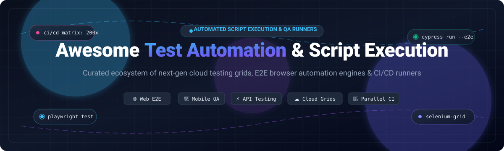

<p align="center">
  
</p>

# 🚀 Awesome Test Automation & Script Execution [](https://awesome.re) [](https://creativecommons.org/publicdomain/zero/1.0/)

> 🎯 A curated, battle-tested collection of premier **Test Automation and Script Execution** platforms, cloud browser & mobile device grids, and open-source execution engines for authoring, running, and scaling automated end-to-end (E2E), API, and performance testing suites across modern CI/CD pipelines.
> 
> ⭐ **Star this repository if you find it valuable!** ⭐

---

## 📑 Table of Contents

- [🌐 Sector Overview & Market Dynamics](#-sector-overview--market-dynamics)
- [🟦 SaaS & Hosted Platforms](#-saas--hosted-platforms)
- [🟩 Open-Source Software](#-open-source-software)
- [📊 Framework & Platform Matrix](#-framework--platform-matrix)
- [💡 Choosing the Right Test Automation Stack](#-choosing-the-right-test-automation-stack)
- [🤝 Contributing](#-contributing)
- [📄 License](#-license)

---

## 🌐 Sector Overview & Market Dynamics

The global **test automation and automated script execution market** is estimated at **$24.2 billion to $34.1 billion** (projected to exceed **$84 billion to $145+ billion** by the mid-2030s at an accelerated 14%–17% CAGR) as continuous testing and automated CI/CD gating become essential for engineering velocity. 

The sector is **highly fragmented** rather than winner-take-all: engineering organizations consistently adopt heterogeneous, multi-layered toolchains—leveraging modern open-source engines for code-first local execution (e.g., Playwright, Cypress, Puppeteer), specialized cloud infrastructure providers for massive parallel cross-browser/cross-device matrices (e.g., BrowserStack, Sauce Labs, LambdaTest), and specialized API execution workspaces (e.g., Postman).

---

## 🟦 SaaS & Hosted Platforms

Commercial, cloud-hosted Test Automation and Script Execution platforms sorted descending by company scale (valuation / annual revenue).

| 🏢 Platform | 💰 Scale (Valuation / Revenue) | 🏷️ Starting Pricing Tier | 🎁 Free Tier / Free Trial Limits | 🎯 Primary Focus & Strengths |
|---|---|---|---|---|
| **[Postman](https://www.postman.com/)** | **$5.6B valuation** (~$313M ARR) | **$19/user/month** (Team, billed annually; $29/mo monthly) or $9/mo (Solo) | **Free Forever:** 1 user, 10,000 Postman API calls/mo, 1,000 monitor calls/mo, 5 cloud integrations, and unlimited local collection runs | Comprehensive API automated testing, Newman/Postman CLI runner, pre/post-request scripts, and mock servers. |
| **[BrowserStack](https://www.browserstack.com/)** | **$4.0B valuation** (~$230M ARR) | **$29/user/month** (Live Desktop, annual) or **$99/month** (Automate, 1 parallel thread, annual) | **Free Trial:** 30 mins Live desktop/mobile manual testing, 60 mins Automate cross-browser, 100 mins App Automate; **Percy Visual:** 5,000 free screenshots/month | Massive cloud matrix of 3,000+ real mobile devices and desktop browsers with instant parallel execution and Percy visual testing. |
| **[TestComplete](https://smartbear.com/product/testcomplete/)** *(SmartBear)* | **$3.0B valuation** (~$500M+ SmartBear ARR) | **$1,210/user/year** (Base Node-Locked) to **$2,500+/year** (Pro/Floating licenses) | **14-day Free Trial:** Fully functional trial with unrestricted access to desktop, web, and mobile GUI object recognition and test recording | Enterprise desktop, web, and legacy client GUI test automation with scriptless AI visual object recognition and multi-language scripting (Python/JS/VBScript). |
| **[LambdaTest](https://www.lambdatest.com/)** | **$400M valuation** (~$50M+ ARR) | **$15/user/month** (Live Testing, annual) or **$79/month** (Automation, 1 parallel test, annual) | **Free Forever:** 60 mins/month real browser live testing (10-min sessions), 10 responsive screenshot tests, 1 parallel test; **Smart UI:** 2,000 free screenshots lifetime limit | HyperExecute high-speed containerized parallel test orchestration, AI-driven test analytics, Smart UI visual diffing, and cross-browser testing. |
| **[Sauce Labs](https://saucelabs.com/)** | **$151M raised** (~$92M ARR) | **$39/month** (Live Testing, annual) or **$149/month** (Virtual Device Cloud, 1 parallel test, annual) | **28-day Free Trial:** 60 automated and live testing minutes, up to 3 parallel virtual machines, access to real mobile devices and Sauce AI authoring | Cloud test execution grid supporting Selenium, Appium, Playwright, and Cypress across real device clouds, virtual emulators, and error analytics. |

---

## 🟩 Open-Source Software

Community-driven, open-source Test Automation frameworks and script execution engines, sorted descending by GitHub stargazers count.

### 1. [Playwright](https://github.com/microsoft/playwright) [](https://github.com/microsoft/playwright/stargazers)
* **GitHub Repository:** [microsoft/playwright](https://github.com/microsoft/playwright)
* **Stack:** TypeScript / JavaScript / Python / Java / C# | **License:** Apache-2.0
* **Overview:** Playwright (developed by Microsoft) has become the gold standard in modern web end-to-end testing. It features native, single-API cross-browser execution across Chromium, WebKit (Safari), and Firefox. Differentiators include auto-waiting, resilient web-first assertions, multi-context browser isolation, network payload mocking, UI Mode with time-travel debugging, and the powerful Trace Viewer.
* **Best For:** Teams building modern web applications wanting bulletproof cross-browser reliability, lightning-fast execution, and zero test flakiness.

### 2. [Puppeteer](https://github.com/puppeteer/puppeteer) [](https://github.com/puppeteer/puppeteer/stargazers)
* **GitHub Repository:** [puppeteer/puppeteer](https://github.com/puppeteer/puppeteer)
* **Stack:** JavaScript / TypeScript (Node.js) | **License:** Apache-2.0
* **Overview:** Maintained by the Google Chrome team, Puppeteer provides a high-level DevTools protocol and WebDriver BiDi client to control Chrome, Chromium, and Firefox. It excels at headless script execution, automated PDF generation, single-page application (SPA) pre-rendering, performance timeline harvesting, and synthetic user journey testing.
* **Best For:** Headless browser automation, web scraping, server-side UI rendering, and Chrome-first performance and synthetic scripting.

### 3. [Cypress](https://github.com/cypress-io/cypress) [](https://github.com/cypress-io/cypress/stargazers)
* **GitHub Repository:** [cypress-io/cypress](https://github.com/cypress-io/cypress)
* **Stack:** JavaScript / TypeScript | **License:** MIT
* **Overview:** Cypress is an in-browser developer-centric testing framework tailored for modern frontend development. Running in the same run-loop as your application, Cypress provides instantaneous feedback, interactive time-travel snapshotting, native spy/stub capabilities, and dedicated component testing harnesses for React, Vue, and Angular.
* **Best For:** Frontend engineering teams prioritizing developer experience, fast feedback loops, and unified component plus end-to-end testing.

### 4. [Selenium WebDriver](https://github.com/SeleniumHQ/selenium) [](https://github.com/SeleniumHQ/selenium/stargazers)
* **GitHub Repository:** [SeleniumHQ/selenium](https://github.com/SeleniumHQ/selenium)
* **Stack:** Java / Python / C# / Ruby / JavaScript / Kotlin | **License:** Apache-2.0
* **Overview:** The foundational pillar of browser automation and the W3C WebDriver standard. Selenium provides ubiquitous cross-browser, multi-language driver bindings and features Selenium Grid for distributed multi-node parallel test execution. Selenium Manager automatically configures and fetches browser binaries without manual driver paths.
* **Best For:** Enterprise test suites requiring multi-language compatibility, legacy browser integration, and maximum cloud infrastructure support.

### 5. [k6](https://github.com/grafana/k6) [](https://github.com/grafana/k6/stargazers)
* **GitHub Repository:** [grafana/k6](https://github.com/grafana/k6)
* **Stack:** Go (Engine) / JavaScript (Test Scripting) | **License:** AGPL-3.0
* **Overview:** Maintained by Grafana Labs, k6 is an ultra-performant modern load and script execution engine. Tests are authored in clean ES6 JavaScript while the execution core is powered by Go, consuming minimal memory and CPU to generate tens of thousands of concurrent requests from a single node. Includes native browser automation support (k6 browser) for hybrid frontend and backend performance testing.
* **Best For:** High-concurrency load testing, API performance regression benchmarking, and developer-friendly performance test automation in CI pipelines.

### 6. [Locust](https://github.com/locustio/locust) [](https://github.com/locustio/locust/stargazers)
* **GitHub Repository:** [locustio/locust](https://github.com/locustio/locust)
* **Stack:** Python | **License:** MIT
* **Overview:** Locust is an open-source, scriptable load testing tool where user journeys are defined directly as idiomatic Python code. It features a distributed, event-driven architecture using gevent coroutines to simulate millions of simultaneous users across clustered machines, backed by an interactive real-time web UI for live metrics and throughput analysis.
* **Best For:** Python engineering teams desiring distributed, code-defined load testing without cumbersome XML or UI-heavy scenario builders.

### 7. [Appium](https://github.com/appium/appium) [](https://github.com/appium/appium/stargazers)
* **GitHub Repository:** [appium/appium](https://github.com/appium/appium)
* **Stack:** Node.js / Java / Python / JavaScript / Ruby / C# | **License:** Apache-2.0
* **Overview:** Appium is the industry-standard mobile test automation engine supporting native, hybrid, and mobile web applications across iOS and Android. Built on the W3C WebDriver protocol, it translates standardized commands into vendor-provided automation backends (Apple XCUITest and Google UiAutomator2), preserving test code portability across mobile operating systems.
* **Best For:** Cross-platform mobile application automation on real devices, emulators, and simulators.

### 8. [Robot Framework](https://github.com/robotframework/robotframework) [](https://github.com/robotframework/robotframework/stargazers)
* **GitHub Repository:** [robotframework/robotframework](https://github.com/robotframework/robotframework)
* **Stack:** Python | **License:** Apache-2.0
* **Overview:** Robot Framework is a mature, keyword-driven and acceptance-test-driven (ATDD/BDD) test automation framework. Its human-readable tabular syntax empowers technical and non-technical QA analysts alike. It features an extensive modular library ecosystem for web (SeleniumLibrary, Browser/Playwright library), mobile (AppiumLibrary), and API testing.
* **Best For:** Enterprise QA organizations requiring keyword-driven, readable test authoring across heterogeneous environments.

### 9. [WebdriverIO](https://github.com/webdriverio/webdriverio) [](https://github.com/webdriverio/webdriverio/stargazers)
* **GitHub Repository:** [webdriverio/webdriverio](https://github.com/webdriverio/webdriverio)
* **Stack:** JavaScript / TypeScript | **License:** MIT
* **Overview:** An extensible next-generation browser and mobile test automation framework for Node.js. WebdriverIO supports both classical WebDriver and modern WebDriver BiDi protocols with native support for Chrome DevTools. Features built-in mock services, visual regression plugins, and deep integrations with cloud device providers.
* **Best For:** Full-stack JavaScript and TypeScript teams looking for an adaptable, plugin-rich framework spanning browser, mobile, and desktop.

### 10. [Artillery](https://github.com/artilleryio/artillery) [](https://github.com/artilleryio/artillery/stargazers)
* **GitHub Repository:** [artilleryio/artillery](https://github.com/artilleryio/artillery)
* **Stack:** Node.js / TypeScript | **License:** MPL-2.0
* **Overview:** Artillery is a cloud-native, developer-first load testing and automated script execution tool designed for SREs and developers. It supports HTTP, WebSockets, Socket.io, and gRPC, and enables serverless distributed execution across AWS Lambda and AWS ECS Fargate without managing testing server fleets.
* **Best For:** Serverless distributed performance testing, API load testing, and continuous SRE regression checks directly in CI/CD.

### 11. [Karate](https://github.com/karatelabs/karate) [](https://github.com/karatelabs/karate/stargazers)
* **GitHub Repository:** [karatelabs/karate](https://github.com/karatelabs/karate)
* **Stack:** Java (DSL-based) | **License:** MIT
* **Overview:** Karate unifies API testing (REST, GraphQL, SOAP), API contract validation, mock servers, and UI automation under a single expressive domain-specific language. Eliminates boilerplate code by offering built-in JSON/XML payload validation, fuzzy matching, and Gatling performance test reuse.
* **Best For:** Teams wanting zero-boilerplate API contract testing, data-driven test tables, and unified functional-to-performance test reuse.

### 12. [Taiko](https://github.com/getgauge/taiko) [](https://github.com/getgauge/taiko/stargazers)
* **GitHub Repository:** [getgauge/taiko](https://github.com/getgauge/taiko)
* **Stack:** JavaScript (Node.js) | **License:** Apache-2.0
* **Overview:** Developed by ThoughtWorks, Taiko is a free and open-source Node.js library for automating Chromium-based browsers. Built from the ground up around "smart selectors" that locate page elements based on visual proximity and human semantics rather than brittle XPath or CSS selectors.
* **Best For:** Fast and resilient browser test automation utilizing smart semantic locators and Gauge BDD test suites.

### 13. [VIVIDUS](https://github.com/vividus-framework/vividus) [](https://github.com/vividus-framework/vividus/stargazers)
* **GitHub Repository:** [vividus-framework/vividus](https://github.com/vividus-framework/vividus)
* **Stack:** Java / Groovy | **License:** Apache-2.0
* **Overview:** An all-in-one test automation tool designed for test engineers without programming backgrounds. Uses an expressive, human-readable Gherkin Test Actions Language to orchestrate tests across web, mobile apps, REST APIs, databases, and message brokers with zero code compilation.
* **Best For:** Non-coding QA professionals and manual testers transitioning to automated multi-tier testing workflows.

---

## 📊 Framework & Platform Matrix

| Software / Engine | Category | License | Core Stack | Execution Focus | Code Required | Best Use Case |
|---|---|---|---|---|---|---|
| **[Postman](https://www.postman.com/)** | Commercial SaaS | Proprietary | Cloud / CLI | API & Microservices | Minimal (JS) | API contract validation & collection automation |
| **[BrowserStack](https://www.browserstack.com/)** | Commercial Cloud | Proprietary | Cloud Grid | Cross-browser & Real Mobile | Based on framework | Instant parallel execution across 3,000+ real devices |
| **[TestComplete](https://smartbear.com/product/testcomplete/)** | Commercial Desktop/SaaS | Proprietary | Windows / Cloud | Desktop, Web, Mobile GUI | Optional (Recorder / Script) | Enterprise desktop & Windows GUI automation |
| **[LambdaTest](https://www.lambdatest.com/)** | Commercial Cloud | Proprietary | Cloud / HyperExecute | Cross-browser & Containerized | Based on framework | HyperExecute high-speed parallel container test runs |
| **[Sauce Labs](https://saucelabs.com/)** | Commercial Cloud | Proprietary | Cloud Grid | Browser & Mobile Cloud | Based on framework | Enterprise cloud device grid & mobile error reporting |
| **[Playwright](https://github.com/microsoft/playwright)** | Open-Source Engine | Apache-2.0 | TS/JS/Python/Java/C# | Modern Web E2E | Yes | Cross-browser reliability & auto-wait debugging |
| **[Puppeteer](https://github.com/puppeteer/puppeteer)** | Open-Source Engine | Apache-2.0 | Node.js / TypeScript | Headless Chrome Automation | Yes | PDF generation, scraping, and synthetic scripting |
| **[Cypress](https://github.com/cypress-io/cypress)** | Open-Source Engine | MIT | JS / TypeScript | Web E2E & Component | Yes | Frontend developer experience & in-browser testing |
| **[Selenium](https://github.com/SeleniumHQ/selenium)** | Open-Source Engine | Apache-2.0 | Java/Python/C#/Ruby/JS | Browser Automation Standard | Yes | Broadest language support & cloud grid compatibility |
| **[k6](https://github.com/grafana/k6)** | Open-Source Engine | AGPL-3.0 | Go / JavaScript | Performance & Load Scripting | Yes | High-concurrency load testing & CI performance gating |
| **[Locust](https://github.com/locustio/locust)** | Open-Source Engine | MIT | Python | Distributed Load Testing | Yes | Developer-friendly Python-scripted load simulations |
| **[Appium](https://github.com/appium/appium)** | Open-Source Engine | Apache-2.0 | Multi-language (Node Core) | Native & Hybrid Mobile | Yes | Native iOS (XCUITest) & Android (UiAutomator2) testing |
| **[Robot Framework](https://github.com/robotframework/robotframework)** | Open-Source Framework | Apache-2.0 | Python | Keyword-driven Acceptance | Minimal (Keywords) | Cross-functional team acceptance & tabular test runs |
| **[WebdriverIO](https://github.com/webdriverio/webdriverio)** | Open-Source Engine | MIT | Node.js / TypeScript | Web, Mobile & BiDi | Yes | Extensible JavaScript test architecture & BiDi sessions |
| **[Artillery](https://github.com/artilleryio/artillery)** | Open-Source Engine | MPL-2.0 | Node.js / TypeScript | Cloud-Native SRE Load | Yes / YAML | Serverless load test execution on AWS Lambda/Fargate |
| **[Karate](https://github.com/karatelabs/karate)** | Open-Source Framework | MIT | Java DSL | REST / GraphQL / SOAP APIs | Minimal (DSL) | Zero-boilerplate API contracts & test payload mocks |
| **[Taiko](https://github.com/getgauge/taiko)** | Open-Source Library | Apache-2.0 | Node.js | Smart Locator Web E2E | Yes | Proximity-based smart selector browser automation |
| **[VIVIDUS](https://github.com/vividus-framework/vividus)** | Open-Source Framework | Apache-2.0 | Java / Groovy | Multi-tier Low-Code | No (Gherkin) | No-code multi-tier QA test suites in CI pipelines |

---

## 💡 Choosing the Right Test Automation Stack

```
                                ┌──────────────────────────────────────────────┐
                                │ What is your primary test automation target? │
                                └──────────────────────┬───────────────────────┘
                                                       │
        ┌──────────────────────┬───────────────────────┼───────────────────────┬──────────────────────┐
        ▼                      ▼                       ▼                       ▼                      ▼
  [Modern Web E2E]       [Mobile Apps]           [API & Services]         [Load & Perf]         [Desktop / GUI]
        │                      │                       │                       │                      │
   Playwright /           Appium /               Karate / Postman        k6 / Locust /          TestComplete /
   Cypress / Taiko        BrowserStack Cloud     Artillery               Artillery              Robot Framework
```

1. **For Modern Web Applications:** **[Playwright](https://github.com/microsoft/playwright)** is the recommended default choice for greenfield web applications due to its auto-wait semantics, fast execution, full WebKit/Chromium/Firefox coverage, and robust trace recording.
2. **For Frontend Component Testing:** **[Cypress](https://github.com/cypress-io/cypress)** provides unparalleled developer feedback loops inside real browser contexts with dedicated component mounting.
3. **For High-Concurrency Performance & Stress Testing:** **[k6](https://github.com/grafana/k6)** and **[Locust](https://github.com/locustio/locust)** empower engineering teams to author load tests as code and run them in CI/CD pipelines.
4. **For Massive Cross-Browser & Device Matrices:** Pair open-source runners with cloud execution platforms like **[BrowserStack](https://www.browserstack.com/)**, **[LambdaTest](https://www.lambdatest.com/)**, or **[Sauce Labs](https://saucelabs.com/)** to avoid managing costly in-house device labs.
5. **For Non-Programmer / Low-Code QA Teams:** **[Robot Framework](https://github.com/robotframework/robotframework)** and **[VIVIDUS](https://github.com/vividus-framework/vividus)** provide accessible keyword and Gherkin-driven authoring formats.

---

## 🤝 Contributing

Contributions, suggestions, and corrections are welcome! 

1. 🍴 Fork the repository.
2. 🌿 Create a feature branch: `git checkout -b feature/new-automation-tool`.
3. 📝 Add the tool to the appropriate section with complete metadata, accurate pricing/stargazers links, and verified technical strengths.
4. 🚀 Commit your changes: `git commit -m "Add ToolName to awesome-test-automation-script-execution"`.
5. 📤 Push to your branch and open a Pull Request!

---

## 📄 License

This compilation is licensed under the [Creative Commons Zero v1.0 Universal](https://creativecommons.org/publicdomain/zero/1.0/) (CC0 1.0 - Public Domain Dedication). All product names, logos, and brands are property of their respective owners.

---

<p align="center">
  <sub>Built with care for the QA and software engineering community. Star ⭐ this repository if you find it helpful!</sub>
</p>
